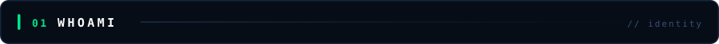
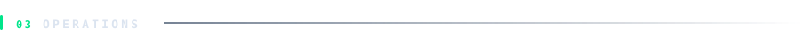
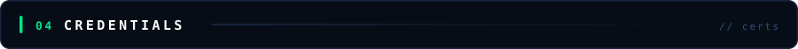

  

  

  
  
  
  

I break systems before someone with worse intentions does. Web apps, APIs, cloud estates and mobile — recon through exploitation, then a report a developer can actually ship a fix from.

Ranked **#1 globally on TryHackMe** (2022) and currently **top 83 worldwide in the PortSwigger Hall of Fame**. Every engagement is mapped to **NIST SP 800-53** and **ISO 27001**, so findings arrive in the language your compliance team already speaks.

<table width="100%">
  <tr>
    <td width="46%" valign="top">

**Based in** — Cairo, Egypt 
**Focus** — Web · API · Cloud · Mobile 
**Certified** — eWPTX · eMAPT · CAP · CNSP 
**Method** — OWASP Top 10 · MITRE ATT&amp;CK

  </td>
    <td width="54%" valign="top">

**Currently** 
Bug bounty hunting across enterprise programs. 5+ high-severity findings responsibly disclosed — including a critical chain on **TikTok**.  
Also building Python and Bash tooling to make recon and reporting faster than doing it by hand.

  </td>
  </tr>
</table>

  
  
  
  
  
  
  
  

  
  
  
  
  
  

  
  
  
  
  
  
  
  

<table width="100%">
  <tr>
    <th align="left" style="width:32%">Project</th>
    <th align="left" style="width:52%">What it does</th>
    <th align="left" style="width:16%">Stack</th>
  </tr>
  <tr>
    <td><a href="https://github.com/Yousif-e1/Malware-Analysis-and-Prevention-Strategy"><b>Malware Analysis &amp; Prevention</b></a></td>
    <td>End-to-end malware behaviour lab with real-time SIEM detection and a hardening playbook</td>
    <td>Wazuh · Splunk</td>
  </tr>
  <tr>
    <td><a href="https://github.com/Yousif-e1/Network-Packet-Analyzer"><b>Network Packet Analyzer</b></a></td>
    <td>Sniffer that surfaces live traffic, protocols and payloads for traffic triage</td>
    <td>Python</td>
  </tr>
  <tr>
    <td><a href="https://github.com/Yousif-e1/Simple-Keylogger"><b>Simple Keylogger</b></a></td>
    <td>Keystroke-capture PoC used to demonstrate endpoint threat exposure</td>
    <td>Python</td>
  </tr>
  <tr>
    <td><a href="https://github.com/Yousif-e1/Password-Complexity-Checker"><b>Password Complexity Checker</b></a></td>
    <td>Scores password strength against real-world guessing patterns</td>
    <td>Python</td>
  </tr>
  <tr>
    <td><a href="https://github.com/Yousif-e1/Pixel-Manipulation-for-Image-Encryption"><b>Image Encryption</b></a></td>
    <td>Encrypts and decrypts images through pixel-level manipulation</td>
    <td>Python</td>
  </tr>
  <tr>
    <td><a href="https://github.com/Yousif-e1/CipherText_Program"><b>CipherText</b></a></td>
    <td>Text encryption and decryption across classical ciphers by key and mode</td>
    <td>Python</td>
  </tr>
</table>

<table width="100%">
  <tr>
    <th align="left" style="width:14%">Cert</th>
    <th align="left" style="width:54%">Full name</th>
    <th align="left" style="width:32%">Issuer</th>
  </tr>
  <tr>
    <td><b>eWPTX</b></td>
    <td>Web Application Penetration Tester eXtreme</td>
    <td>INE Security</td>
  </tr>
  <tr>
    <td><b>eMAPT</b></td>
    <td>Mobile Application Penetration Tester</td>
    <td>INE Security</td>
  </tr>
  <tr>
    <td><b>CAP</b></td>
    <td>Certified AppSec Practitioner</td>
    <td>SecOps Group</td>
  </tr>
  <tr>
    <td><b>CNSP</b></td>
    <td>Certified Network Security Practitioner</td>
    <td>SecOps Group</td>
  </tr>
</table>

**DEPI** professional program (2024–2025) — curriculum aligned with Security+, CEH v12, Network+, CCNA Cyber Ops, Linux+ and eWPT.

<table width="100%">
  <tr>
    <th align="left" style="width:50%">Reach me</th>
    <th align="left" style="width:50%">Open to</th>
  </tr>
  <tr>
    <td valign="top">

 

  </td>
    <td valign="top">

Full-time red team / offensive security roles 
Contract penetration testing engagements 
Security research collaborations

  </td>
  </tr>
</table>

  Every finding above was reported privately to the vendor before publication. Testing is only ever performed against systems I am authorised to assess.

