  

  

  
  
  
  

**I break systems before someone with worse intentions does.**

Web apps, APIs, cloud estates and mobile — recon through exploitation, then a report a developer can actually ship a fix from. Every engagement is mapped to **NIST SP 800-53** and **ISO 27001**, so findings arrive in the language your compliance team already speaks.

Ranked **#1 globally on TryHackMe** (2022) and **top 83 worldwide in the PortSwigger Hall of Fame**. 5+ high-severity findings responsibly disclosed, including a critical chain on **TikTok**.

<table width="100%">
  <tr>
    <td width="50%" valign="top">
      
<b>Focus</b>

      Web · API · Cloud · Mobile 
      OWASP Top 10 · MITRE ATT&amp;CK 
      NIST SP 800-53 · ISO 27001
    </td>
    <td width="50%" valign="top">
      
<b>Now</b>

      Bug bounty hunting across enterprise programs. 
      Building Python and Bash tooling for recon and reporting. 
      Open to red team and contract pentest work.
    </td>
  </tr>
</table>

<table width="100%">
  <tr>
    <td width="50%" valign="top">
      
<b><a href="https://github.com/Yousif-e1/Malware-Analysis-and-Prevention-Strategy">Malware Analysis &amp; Prevention</a></b>

      End-to-end malware behaviour lab with real-time SIEM detection and a hardening playbook. 
      Wazuh · Splunk
    </td>
    <td width="50%" valign="top">
      
<b><a href="https://github.com/Yousif-e1/Network-Packet-Analyzer">Network Packet Analyzer</a></b>

      Sniffer that surfaces live traffic, protocols and payloads for traffic triage. 
      Python
    </td>
  </tr>
  <tr>
    <td width="50%" valign="top">
      
<b><a href="https://github.com/Yousif-e1/Simple-Keylogger">Simple Keylogger</a></b>

      Keystroke-capture PoC used to demonstrate endpoint threat exposure. 
      Python
    </td>
    <td width="50%" valign="top">
      
<b><a href="https://github.com/Yousif-e1/Password-Complexity-Checker">Password Complexity Checker</a></b>

      Scores password strength against real-world guessing patterns. 
      Python
    </td>
  </tr>
  <tr>
    <td width="50%" valign="top">
      
<b><a href="https://github.com/Yousif-e1/Pixel-Manipulation-for-Image-Encryption">Image Encryption</a></b>

      Encrypts and decrypts images through pixel-level manipulation. 
      Python
    </td>
    <td width="50%" valign="top">
      
<b><a href="https://github.com/Yousif-e1/CipherText_Program">CipherText</a></b>

      Text encryption and decryption across classical ciphers by key and mode. 
      Python
    </td>
  </tr>
</table>

  
  
  
  
  
  
  
  

  
  
  
  
  
  

  
  
  
  
  
  
  
  

Recon → enumeration → exploitation → post-exploit → reporting. No stage skipped — most real findings hide in enumeration, not in the exploit.

<table width="100%">
  <tr>
    <td width="25%" valign="top" align="center">
      
<b>eWPTX</b>

      Web App Pentester eXtreme 
      INE Security
    </td>
    <td width="25%" valign="top" align="center">
      
<b>eMAPT</b>

      Mobile App Pentester 
      INE Security
    </td>
    <td width="25%" valign="top" align="center">
      
<b>CAP</b>

      Certified AppSec Practitioner 
      SecOps Group
    </td>
    <td width="25%" valign="top" align="center">
      
<b>CNSP</b>

      Certified Network Security Practitioner 
      SecOps Group
    </td>
  </tr>
</table>

**DEPI** professional program (2024–2025) — Security+, CEH v12, Network+, CCNA Cyber Ops, Linux+ and eWPT.

<b>Experience &amp; education</b>

 

| Role | Organisation | When |
|:--|:--|:--|
| **Bug Bounty Researcher** | Independent | Jul 2026 – Present |
| **Penetration Tester &amp; Vulnerability Analyst** | Refeed (DEPI, remote) | Sep 2025 – May 2026 |

**Education** — BSc Computer Science &amp; AI, MTI · 2021 – 2025

<table width="100%">
  <tr>
    <td width="50%" valign="top">
      
<b>Let's work together</b>

      Full-time red team / offensive security roles 
      Contract penetration testing engagements 
      Security research collaborations
    </td>
    <td width="50%" valign="top">
      
<b>Reach me</b>

       
      
    </td>
  </tr>
</table>

  Every finding above was reported privately to the vendor before publication. Testing is only ever performed against systems I am authorised to assess.

